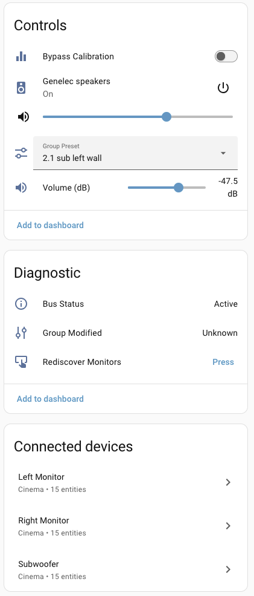
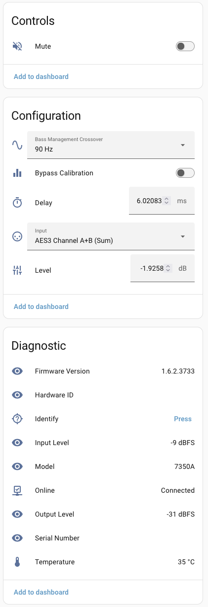

# espgensam

**espgensam** is an **unofficial** [ESPHome](https://esphome.io/) component and firmware that turns an ESP32 with an RS-485 transceiver into a standalone controller for [**Genelec SAM (Smart Active Monitor) speakers**](https://www.genelec.com/sam-studio-monitors-subwoofers), communicating natively over the Genelec "GLM" bus and exposing monitor control directly to **Home Assistant**.

---

## Features

- **Speaker Controls**: Direct volume, mute, power/standby, input select, and telemetry reporting.
- **Group Presets**: Switch between named calibrations (GLM's "groups") from Home Assistant, each with its own room EQ, level, delay, crossover and input routing per speaker. Read straight from your existing GLM 5 setup file. A Bypass Calibration switch turns the calibration off for a quick before-and-after comparison.
- **No GLM software or GLM network adapter required**: Control monitors locally, using a cheap ESP32 microcontroller and RS-485 transceiver.
- **Native Home Assistant Integration**: Control your Genelec SAM system from Home Assistant (optional)
- **TV Remote Volume**: [`tools/cec_audio_bridge`](tools/cec_audio_bridge/README.md) makes a Raspberry Pi on the HDMI bus act as the CEC audio system, so TV, projector and Apple TV volume keys control the monitors through Home Assistant.




> **Use of this code is entirely at your own risk!** I can't rule out that this could damage your Genelec or computer hardware, eat your tweeters, void your warranty, cause hearing damage, or, last but not least, ruin your audio fidelity. You have been warned.

You may also want to take a look at [HLM, the Homebrew Loudspeaker Manager](https://github.com/robcazzaro/hlm), which is a similar project to control Genelec SAM monitors from a (STM32/ESP32) microcontroller. It already implements most of the protocol's functionality. We have started collaborating to better understand the underlying GLM protocol.

---

## Supported Hardware

`espgensam.yaml` is the device configuration. Copy `secrets.yaml.example` to the ignored
`secrets.yaml` for private credentials, and `espgensam-local.yaml.example` to the ignored
`espgensam-local.yaml` for your own settings. `espgensam.yaml` includes the local file as its
`substitutions:`, so keep every key from the example and edit the values:

```yaml
board: "waveshare_esp32s3_rs485_can"
name: "espgensam"
friendly_name: "Genelec SAM Controller"
listen_only: "false"
min_volume_db: "-80.0"
max_volume_db: "-30.0"
startup_volume_db: "-50.0"
control_window: "60s"
discovery_slots: "2"
log_level: "INFO"
```

`espgensam-local.yaml` controls the board, controller name, volume limits, speaker entity count, and log
level. `secrets.yaml` and `espgensam-local.yaml` are ignored by Git; do not commit them. `secrets.yaml` holds the Wi-Fi/AP
credentials and ESPHome API encryption key. The example API key is public; replace it before
connecting to Home Assistant. The included board and shared GenSAM packages stay reusable project
files. Choose a board with `board` (see [Selecting a board](#selecting-a-board)). Set
`discovery_slots` in `espgensam-local.yaml` to your speaker count (0–32). The example starts
at 2 slots; the shared package defaults to 16 only when this substitution is omitted. Rebuild
and flash after changing it. These fixed
speaker entity slots are assigned in stable hardware-ID order as monitors are discovered.
Use `0` for system/group controls without individual speaker entities. This setting limits only
individual entities, not bus discovery.
Additional monitors still receive uploaded group settings but do not get individual Home Assistant
controls.

Each discovery slot automatically gets its own Home Assistant device named `Monitor 1`,
`Monitor 2`, and so on. No `esphome: devices:` declarations or `device_id` settings are
needed. On the device web page (web server version 3) each monitor gets its own card, named
after the monitor, holding all of its entities: mute, input, bypass, crossover, level and delay
first, then online status, input level, output level, temperature, model, serial number,
firmware version, hardware ID, identify and SAM name. Diagnostic tweeter, midrange and woofer
coil temperatures, main and low supply voltages, and processor load are also created and enabled
by default; each stays unknown on models that do not report it (supply rails come from three-way
models only, processor load from firmware 1.12 onwards). Previously registered disabled entities
must be enabled in Home Assistant; firmware updates do not change their registry settings.
Cards follow the System Controls and
Group Preset sections in slot order. Entities on a sub-device use short names such as
`Temperature`; ESPHome displays the device name alongside them. Switching an existing slot to
these names may create new Home Assistant entities, so check dashboards and automations.

`discovery_slot_settings` overrides this per slot. A `device_id` maps a slot to an existing
ESPHome device instead of its generated one. A `web_server:` block replaces the automatic card,
for example to place a slot in a sorting group of your own:

```yaml
web_server:
  sorting_groups:
    - id: front_speakers
      name: "Front Speakers"

gensam:
  discovery_slot_settings:
    - slot: 1
      web_server:
        sorting_group_id: front_speakers
```

Add these entries to the existing `web_server:` and `gensam:` sections, rather than creating
duplicate sections. The slot number must not exceed `discovery_slots`. The optional
`sorting_weight` in a slot's `web_server:` block sets the online status weight (default 50);
items are spaced by 10, with the controls before it.
The numbered slots are not permanent
speaker identities: assignments are retained during rediscovery but may differ after restart
or changes in the discovered monitors. Existing Home Assistant entity organization may change.

### Selecting a board

`espgensam.yaml` includes `packages/board_${board}.yaml`, where `board` is a substitution.
Set it in `espgensam-local.yaml`, or override it for a
single run with `-s`:

| `board` | Hardware |
| --- | --- |
| `waveshare_esp32s3_rs485_can` | Waveshare ESP32-S3-RS485-CAN |
| `m5stack_atoms3_rs485_base` | M5Stack AtomS3 Lite + Atomic RS485 Base |
| `m5stack_atoms3_rs485_iso` | M5Stack AtomS3 Lite + Isolated RS485 Unit |

```bash
esphome -s board m5stack_atoms3_rs485_iso run espgensam.yaml
```

A board package declares pins and peripherals only. To add a board, create
`packages/board_<name>.yaml`; it is then selectable as `board: "<name>"`. An unknown name
fails with `Error including file 'packages/board_<name>.yaml'`.

### Recommended boards:

#### 1. [Waveshare ESP32-S3-RS485-CAN](https://www.waveshare.com/esp32-s3-rs485-can.htm?srsltid=AU7gw4XHCvv7kp2jIgnAUvVmN92_7ne11_kTLRfJZ86YqEoc0iASMILK)
- **MCU**: ESP32-S3 dual-core
- **RS485 TX**: `GPIO17`
- **RS485 RX**: `GPIO18`
- **Direction Control**: Explicit, `GPIO21` (SP3485EN; `/RE` is tied to `DE`, so the receiver is disabled while transmitting)
- **Isolation**: Galvanically isolated RS-485, with an onboard 120 Ω termination and 4.7 kΩ fail-safe bias
- **Status RGB LED**: none — the onboard LEDs are power and bus-activity indicators.
- **Rediscover button**: none — use the **Rediscover Monitors** button entity.

**Make sure the bus has exactly one terminator at the controller end.**  In practice: the board ships with its 120 Ω enabled through a jumper, and a GLM adapter carries one too — a passive resistor, so it terminates whether or not the adapter is powered. **Adapter attached → pull the Waveshare jumper. Waveshare alone → leave it in.**

### NOT recommended:

#### 2. M5Stack AtomS3 Lite + Atomic RS485 Base
- **MCU**: ESP32-S3 dual-core
- **RS485 TX**: `GPIO6`
- **RS485 RX**: `GPIO5`
- **Direction Control**: Automatic (Atomic RS-485 pulse-sensing circuit)
- **Isolation**: NOT electrically isolated
- **Status RGB LED**: `GPIO35` (WS2812)
- **Rediscover button**: `GPIO41`

While this hardware does work in practice, it has proven not to be ideal hardware for this use case due to the auto-direction circuit. **It's also not electrically isolated**, so more risky with e.g. ground loops through your Genelec or computer hardware.

> **This board needs a terminator somewhere on the bus.** The Atomic RS485 Base has no termination resistor of its own (M5Stack's docs tell you to add one), and with nothing else attached it does not communicate at all — not degraded, dead. A GLM adapter's TERMINATOR port is enough, with the adapter otherwise idle. Running standalone, fit a 120 Ω across `A`/`B`.

### 3. M5Stack AtomS3 Lite + Isolated RS485 Unit (RS485-ISO)
- **MCU**: ESP32-S3 dual-core
- **RS485 TX**: `GPIO2` — Grove Port A, yellow wire
- **RS485 RX**: `GPIO1` — Grove Port A, white wire
- **Direction Control**: Automatic (CA-IS3082W with `/RE` tied to `DE`, `DI` grounded, and our TX line inverted onto that pin — the driver is on only while a `0` is on the wire, and a `1` is the line released to the bias)
- **Isolation**: Galvanically isolated RS-485 with its own isolated DC-DC, rated 1000 V<sub>RMS</sub>; 4.7 kΩ fail-safe bias, **no termination fitted**
- **Status RGB LED**: `GPIO35` (WS2812)
- **Rediscover button**: `GPIO41`

> **Not recommended.** In three hours of normal listening this combination lost the entire monitor bus several times. It recovers unaided, but recovery re-runs speaker configuration, which deliberately silences output — so each event is a few seconds of audio dropout. An earlier session also enumerated a phantom monitor from a corrupted discovery reply. Entry 1 has never done either in weeks of use.
>
> Note this is *despite* better frame-level integrity than entry 1 (0.38% CRC against 1.59%). Its failures are at enumeration level rather than frame level, and only the former is audible. See [docs/rs485-transceiver-comparison.md](docs/rs485-transceiver-comparison.md) §4.
- **Fit the 120 Ω that comes in the box, or terminate elsewhere.** Nothing is fitted on the unit and there is no jumper for one.

---

## RJ45 "GLM" Cable Pinout

Connect the RS-485 transceiver terminal block to a standard CAT5/6 RJ45 patch cable wired to **T568B**:

| RJ45 Pin (T568B) | Wire Color | GLM Bus Signal | RS485 Terminal |
|---|---|---|---|
| **Pin 1** | White / Orange | **Data A (D+)** (non-inverting) | `A` |
| **Pin 2** | Orange | **Data B (D-)** (inverting) | `B` |
| **Pin 8** | Brown | **GND** (bus ground reference) | `GND` |
| Pins 3–7 | — | *Unconnected* | — |

The `GND` row is board-dependent. **The Waveshare's RS-485 terminal block has only `A` and `B`** — there is no ground terminal, so pin 8 is simply left unconnected there, and the board works correctly that way. Its fail-safe bias network ties `A` to the isolated 3V3 rail and `B` to the isolated ground, so the isolated side already self-references to the bus through 4.7 kΩ and never actually floats. The Isolated RS485 Unit is the same in this respect: its four-way terminal is `SHIELD` / unconnected / `A` / `B`, the bus-side ground reaches the `SHIELD` pin only through 1 MΩ ∥ 1 nF, and it biases `A`/`B` against its isolated 5 V rail through the same 4.7 kΩ pair.

---

## Configuration Reference

### 1. Hub & Monitor Configuration (`gensam:`)

The pin keys belong in a board package; everything else is board-independent and lives in `packages/gensam.yaml`. They are shown together here for reference.

```yaml
gensam:
  id: gensam_hub

  # --- Transceiver pins (board package) ---
  tx_pin: GPIO6
  rx_pin: GPIO5
  # de_pin: GPIO21      # Direction line, driven per frame. Omit on auto-direction modules.
  # re_pin: GPIO17      # Receiver enable, asserted once at boot.
  # power_pin: GPIO16   # 5 V DC-DC booster enable, for modules with their own rail.
  # se_pin: GPIO19      # Transceiver enable / shutdown, asserted once at boot.
  # tx_echoes_rx: false # Whether any of our own transmission can reach RX. Defaults to
  #                     # "no de_pin configured", which is right for every supported board. An
  #                     # auto-direction module's one-shot is triggered by our own start bit, so
  #                     # it is always late and the opening bits escape; a deliberately driven
  #                     # direction line is asserted first and leaks nothing. Set it only for a
  #                     # board that drives DE but leaves its receiver permanently enabled —
  #                     # getting it wrong the other way discards the start of every reply.
  # All pin keys accept `inverted: true`. `mode:` is ignored: the driver configures pull-ups
  # itself, and RMT rebinds tx_pin/rx_pin regardless.

  rx_buffer_size: 512

  # Coexistence with official GLM USB adapter
  yield_to_glm: true
  glm_inactivity_cooldown: 30s

  # Timing and filtering
  poll_interval: 1s                   # RS-485 physical keep-alive sampling
  volume_tx_interval: 50ms            # Fastest rate volume changes are sent to the monitors
  telemetry_averaging_period: 60s     # In-memory averaging window for signal levels

  # System volume bounds
  min_volume_db: -80.0
  max_volume_db: 0.0
  startup_volume_db: -30.0            # Initial volume on boot

  rediscover_button:
    name: "Rediscover Monitors"

  # Individual entity slots (0-32, default 16 in packages/gensam.yaml).
  # Each slot shows a discovered monitor's model, serial number, and hardware ID.
  # With the shared package, set discovery_slots in espgensam-local.yaml instead.
  discovery_slots: 16
```

The system is exposed to Home Assistant as controls rather than a media player: **Volume (dB)**,
**Mute**, **System Power** (on means awake), and **Monitor LEDs**. The LED switch controls the
live front-LED state independently of the stored GLM ISS LED preference and the mute switch's
red/off status indication. The switch remains unknown until each discovered monitor's LED state
is observed or commanded; if the monitors disagree, it reports off (not all LEDs are enabled).
Group presets and calibration controls are available separately.

In controller mode, boot wakes the monitors, restores the remembered volume and selected
group, and then suspends **all** transmissions after the control window (`60s` by default).
Set the `control_window` substitution to `0s` to keep polling indefinitely. On first boot,
`startup_volume_db` is used; restored volume is clamped to the configured bounds.
Choose safe bounds before deploying. Preferences are saved through ESPHome's wear-managed
flash mechanism; an abrupt loss of power before its flush can lose recent changes.

Accepted user controls reopen/reset the window. After silence, system volume and mute send
only their control frames: no status probes, polling, wake/discovery or group reload, even
when a cached address no longer answers. Delivery is not confirmed, and sleeping monitors
may not respond. This avoids interrupting playing audio to recover an expired address.
Other controls probe cached monitors first; standby or a missing response triggers wake,
rediscovery and restoration of the selected group, which can interrupt audio. After a
volume/mute-only window, explicitly use System Power on or select a group to force discovery
and restore settings lost during sleep. Group/input changes may intentionally interrupt audio.

`Bus Silent` means telemetry is stale and actual speaker power is unknown, not necessarily off.
Measured telemetry and monitor online indicators become unknown while monitoring is paused;
online status returns when a monitor is next observed. Native ISS/audio wake has no known bus notification.
Silence permits native ISS but does not force it: input signals and AES/EBU clock may keep
speakers awake. Explicit System Power off sends shutdown and then stays silent; subsequent
controls other than system volume/mute can wake again. Listen-only mode never transmits, and
external GLM control takes priority.

ISS sleep and standby reset monitor settings to the defaults stored on each monitor, or to no
stored settings if no defaults have been saved. Session-only settings are lost. An ISS audio
wake may not be detected by the hub, so the selected group may not be reapplied automatically.

**ISS Sleep Delay** and **ISS Sensitivity** (System Controls) override the monitors' stored ISS
settings: GLM's delays from 2 min to 4 h or Never, and Low/Medium/High (−61/−68/−75 dBu).
They are runtime-only. They are never stored on the monitors, so a sleep or restart reverts them,
and the hub re-sends them after each discovery and group push. An override therefore applies to
the next sleep after each wake that the hub handles. *Speaker default* sends nothing. Polling
holds the monitors awake, so ISS can only count down after the control window closes. It is not
yet verified that monitors apply these values without a store; see
[`docs/glm-bus-guide-reconciliation.md`](docs/glm-bus-guide-reconciliation.md) §3.

**Bypass Phase Correction**, disabled by default, bypasses each monitor's phase-correction
filter for comparison. Like Bypass Calibration it is off after a restart, and it is reapplied
after discovery and group pushes. Not every SAM model is confirmed to honour it.

Each monitor gets an **Input** select listing `Analog`, `AES3 Channel A (Left)`,
`AES3 Channel B (Right)` and `AES3 Channel A+B (Sum)`. Routing is per speaker because that is
how the hardware works: a GLM group can perfectly well run the subwoofer on AES3 while both
main monitors are analog, so there is no single system-wide input to select.

Each monitor also gets three calibration controls: **Bass Management Crossover** (`Full band`
for no bass management, or 50-120 Hz), **Level** (-60 to 0 dB, attenuation only) and
**Delay** (0-192 ms). They are
disabled by default, because a group preset normally owns them and overwrites them at its next
push — enable them in Home Assistant for a speaker you want to trim by hand.

The standard device web page provides the controls and group selector. The last successfully
applied group and its speaker settings and PEQ bands are available as JSON at `/group-view`. They
describe the preset, not live readback: bypass, manual changes, offline speakers and a
pending group push can make actual settings differ.

### 3. Group Presets (`gensam: groups:`)

A group preset is a named monitoring configuration, just like the Group buttons in GLM: which
speakers take part, how each is fed, and the room calibration for each of them at one listening
position. Switching between groups from Home Assistant re-sends the whole DSP
block to every speaker.

The **Group Preset** selector lists groups from the uploaded setup. To change the available
groups, upload a new `.sam` file on the [upload page](http://espgensam.local/upload), validate,
and save and restart. A new upload always selects its first group; subsequent selections are
remembered across ESP restarts for that stored setup. This does not write speaker flash.

Groups can also be compiled from `sam_file:` or written by hand for programmatic use, but the
runtime selector does not list them and YAML no longer sets a startup default. Remove
`default_group:` from existing configurations; select the desired group after upload instead.

```yaml
gensam:
  groups: !include gensam_groups.yaml

```

```yaml
# gensam_groups.yaml
- name: "Main Listening Position"
  devices:
    - unique_id: 1842915          # matches a monitor's unique_id above
      source: aes3_sum            # analog | aes3_a | aes3_b | aes3_sum
      crossover: 90               # Hz, or full_band for a system without a subwoofer
      level_db: -1.9258           # per-speaker trim from AutoCal
      delay_samples: 289          # alignment delay, 48 kHz samples (max 9216 = 192 ms)
      lfe_channel: aes3_b         # subwoofers in surround setups only; default none
      lfe_level_db: -4            # whole dB, including the LFE +10 boost if set
      filters:                    # up to 20; the rest are left flat
        - {type: notch, frequency: 56.1739, gain: -6.05847, q: 4.68839}
        - {type: low_shelf, frequency: 118.711, gain: -0.177536}
        - {type: high_shelf, frequency: 14999, gain: -0.0199986}
```

`type` is `notch` (GLM's name for a peaking filter), `peaking` (an alias for `notch`),
`low_shelf`, `high_shelf` or `bypass`. Both `notch` and `peaking` require `q`; the other
types must not specify it. Set `enabled: false` on a device to mute it in that group rather
than configure it.

`lfe_channel` is for a subwoofer in a surround setup, where the discrete ".1" channel reaches
it on its own input alongside the bass-managed program. Leave it out for stereo and 2.1, which
is what `none` means. When it is set, `source` must name a single channel rather than the A+B
sum, so that the LFE feed is not also folded into the program path; importing handles this for
you.

Filter order is the order the speaker's own filter slots run in, which differs by model: a
two-way monitor takes two low shelves, two high shelves and then up to sixteen notches, while
a subwoofer takes twenty notches and no shelves. Importing gets this right; if you write a
group by hand, follow the same order.

Applying a group sets every speaker's Input select, Crossover, Level and Delay - and the LFE
routing and level on a subwoofer that has them - so they always show what the speakers were
last told. Changing one by hand takes effect immediately but does
not alter the group, so the next group push - switching group, waking from standby, or a
rediscovery - puts the group's own values back. While the two disagree, the hub's **Group
Modified** diagnostic sensor is on.

**Bypass Calibration** works like GLM's "Cal bypassed" button, for comparing the system with
and without its calibration. While it is on, every speaker plays with flat EQ, no level trim
and no delay. Crossover, input routing and LFE stay as the group has them. Turning it off puts
the calibration back. It stays in effect across group switches and standby.

- Each speaker also has its own **Bypass Calibration** switch, disabled by default, for
  comparing one speaker at a time. A speaker is bypassed while either switch is on.
- Both switches are off after every restart.
- They exist when groups are configured or runtime upload is enabled. With no active group,
  bypass takes effect when a group is next applied; it cannot restore unknown monitor settings.
- Because the level trim is removed as well, bypassed speakers can play louder than
  calibrated ones.

The system **Mute** switch controls all monitors. Each monitor's own **Mute** switch is a
configuration entity. On the device web page it sits in that speaker's card with its input
and calibration settings; the page places volume, mute, power,
calibration bypass and rediscovery in **System Controls**, with group selection in its own section.

### 4. Importing an existing GLM setup (`gensam: sam_file:`)

Point the hub at a GLM 5 `.sam` setup file and its groups become presets, so an existing AutoCal
calibration does not have to be retyped:

```yaml
gensam:
  sam_file: "My Setup.sam"
```

The file is read while ESPHome validates the configuration, which happens on every
`esphome config`, `compile` and `run`. Re-run calibration, save in GLM, rebuild: there is nothing
to regenerate and no converted file to keep in step. `esphome config` prints the groups in
full, which is how you see what was imported.

Presets appear in the order the setup file lists them, before any you also wrote in `groups:`.
The **Group Preset** selector lists only groups from the uploaded setup; YAML groups have no
startup default.

With no static `monitors:` filter, every device in the file is imported, including speakers that
are currently offline. If a filter is configured, `sam_file:` imports only the listed monitors.
The local-development config instead uses the runtime uploader, which keeps group device IDs
independent of the fixed Home Assistant slots and applies settings to matching speakers
discovered on the bus.

Anything the import cannot carry across is reported rather than dropped quietly. Pay attention
to those warnings: they are the difference between the group sounding as GLM calibrated it,
and sounding off.

Alternatively, upload a `.sam` at runtime from `http://<device-ip>/upload` without rebuilding.
Runtime upload does not use a static `monitors:` filter: it retains all valid devices, including
those not configured or currently online, and applies settings to matching speakers as they are
discovered. The first install after enabling uploads must be over USB to install the runtime
storage partitions. Both import methods read UTF-8 setup files and fall back to Latin-1 for older
files. Runtime uploads also publish each speaker's SAM `Name` as a
per-monitor **SAM Name** diagnostic entity, matched by hardware ID; the numbered monitor entity
slots remain stable even when speakers are renamed or discovered in a different order.

#### Where the file lives

The path is relative to the directory holding your ESPHome YAML, but `~` is expanded and an
absolute path is taken as given, so it can point straight at GLM's own setup directory:

```yaml
  sam_file: "glm/My Setup.sam"
  sam_file: "~/Documents/Genelec/GLM5/Setup Files/My Setup.sam"
```

Building from the ESPHome dashboard or the Home Assistant add-on needs the `.sam` copied into
the configuration directory instead. GLM setup names usually contain spaces, so quote them.

#### If you would rather have the YAML

`tools/sam2yaml.py` runs the same conversion and writes the groups file out, which is the way
to inspect it, diff two GLM exports, or correct a file the component will not accept:

```bash
python3 tools/sam2yaml.py "My Setup.sam" \
    --monitors 1842915,1654321,1987654 \
    -o gensam_groups.yaml
```

`--monitors` does by hand what `monitors:` does automatically. Include the result with
`groups: !include gensam_groups.yaml` and leave `sam_file:` out. The tool needs PyYAML; if your
system Python lacks it, `pip install pyyaml`, or run it with ESPHome's own interpreter.

---

## Getting Started

### 1. Configure the Device

Copy `secrets.yaml.example` to `secrets.yaml` and `espgensam-local.yaml.example` to
`espgensam-local.yaml`, then
set `board`, choose the discovery slot count, and set the controller name and log level.
Monitor devices are generated from the discovery slots. Keep `secrets.yaml` private. The web
interface and OTA are not authenticated or encrypted, so keep the device on a trusted local
network.

### 2. Build & Flash

Build and flash the selected board (see [Supported Hardware](#supported-hardware)):

```bash
esphome run espgensam.yaml
```

The configured speaker slots are populated from discovery; no serial-number list or `devices:`
block is needed. Group membership and settings come from the uploaded `.sam` file.

### 3. Use the device-hosted web interface & SAM uploader

The web server and `/upload` uploader are enabled by default. Flash by USB the first time to install
the required storage partitions. Open [the upload page](http://espgensam.local/upload) (or use the
device IP) to validate a GLM 5 `.sam` file and save and restart. The validation result and any
import warnings appear under the **Validate** button once a file has been uploaded. The
first group is selected initially. After validation, expand the groups and speakers under
**New setup details** to inspect the uploaded file's input routing, level, delay, crossover and LFE feed. Each speaker's PEQ section lists every
imported slot, including its type, active or bypassed status, frequency, gain and Q. Slots are
numbered from 1; shelving filters use fixed Q values. The new-setup preview is shown only for a
validated file and is cleared after a restart. These are imported settings,
not a live readback from the speakers. The main page and Home Assistant show the uploaded group
options.

The remembered selection is applied after discovery. A new upload starts with its first group;
legacy stored defaults remain readable until replaced by a new upload or a remembered selection.
Missing or offline monitors are skipped with a log warning. The web server and uploader use
unauthenticated, unencrypted HTTP, and OTA is unauthenticated. Keep the device on a trusted local
network; never expose these services to the internet.

System volume, mute, and power are exposed as number and switch entities, so they are available in
both Home Assistant and the ESPHome web interface.

## Development and Tests

From the repository root, run the Python regression scripts with a Python environment that has
ESPHome's dependencies installed:

```bash
for test in tests/test_*.py; do python3 "$test" || exit 1; done
```

Some scripts compile host-side C++ fixtures and run the embedded UI's JavaScript checks, so the
suite also requires a C++17 compiler and Node.js. The standalone C++ tests in `tests/test_*.cpp`
each document their compile command at the top of the file. Validate and compile the ESPHome
configuration for every supported board before publishing:

```bash
for board in waveshare_esp32s3_rs485_can m5stack_atoms3_rs485_base m5stack_atoms3_rs485_iso; do
  esphome -s board "$board" config espgensam.yaml &&
    esphome -s board "$board" compile espgensam.yaml || exit 1
done
```

---

## License

This project is licensed under the [GNU General Public License v3.0](LICENSE).
